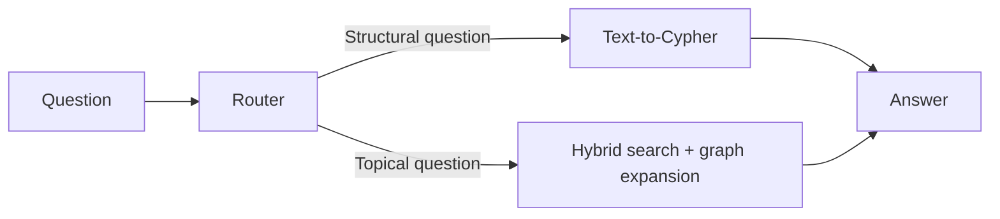

# ArXiv AI — Knowledge Graph & GraphRAG

Explore **arXiv cs.AI** papers as a **Neo4j** graph and query them in English using a
**local LLM** (**Ollama + Qwen3:4b**). 100% local, with no paid APIs.



The router sends questions about graph structure and statistics to text-to-Cypher.
Topical questions use hybrid full-text and vector retrieval, then expand the matching
papers with graph data. If a structural query returns no results, the app falls back to
hybrid retrieval.

## Requirements

[Conda](https://conda.io/projects/conda/en/latest/user-guide/install/index.html), Docker,
and [Ollama](https://ollama.com/download). The Conda environment installs Python 3.11.

## 1. Start Neo4j

```bash
cp .env.example .env        # Then update NEO4J_PASSWORD (at least 8 characters).
docker compose up -d
```

Neo4j Browser: <http://localhost:7474> (credentials are in `.env`).

## 2. Install Ollama and the models

```bash
ollama pull qwen3:4b
ollama pull nomic-embed-text
```

`qwen3:4b` answers questions and generates Cypher. `nomic-embed-text` creates
768-dimensional paper and question embeddings for vector search. To use different models,
download them and update `OLLAMA_MODEL` or `EMBED_MODEL` in `.env`.

## 3. Ingest

```bash
conda env create -f environment.yml
conda activate arxiv-ai-graphrag
python -m src.ingestion.pipeline --limit 50 --offset 0
```

`--limit` sets the number of papers to fetch, and `--offset` selects where to start in
arXiv's results. Increase the offset to ingest older batches (for example, use `--offset
50` for the next 50 results). Papers already ingested as full papers are skipped; use
`--force` to re-ingest them. Cited-paper stubs do not count as already ingested.
Ingestion creates the graph constraints and indexes, fetches papers and citation data,
and creates embeddings when Ollama is available. Activate the environment in each new
terminal.

To add embeddings to existing papers that were ingested before semantic search was
enabled, run `python -m src.ingestion.backfill_embeddings`. Use `--limit` to cap the
number of papers processed, for example `--limit 500`. Omit `--limit` to process all
complete papers that have no embedding.

## 4. Launch the app

```bash
streamlit run app.py
```

Try asking: *"Which papers are cited the most?"* The **View the Cypher query and raw data**
section below each answer lets you inspect the results and verify the response.
Use **Insights** for PageRank rankings, community summaries, and monthly publication counts;
the tab can compute analytics when they are missing. **Graph** renders the selected paper's
one-hop author and citation neighbourhood.

## CLI commands

Run these commands from the repository root with the Conda environment active:

```bash
python -m src.ingestion.pipeline --limit 50 --offset 0
python -m src.ingestion.pipeline --limit 50 --offset 0 --force

python -m src.ingestion.backfill_embeddings
python -m src.ingestion.backfill_embeddings --limit 500

python -m src.database.analytics
python -m pytest
```

`pipeline` accepts `--limit`, `--offset`, and `--force`. Embedding backfill accepts an
optional `--limit`; analytics takes no options.

## Graph analytics

Neo4j starts with the Graph Data Science (GDS) plugin configured in `docker-compose.yml`;
the first container start downloads it. After ingestion, compute PageRank scores and
Leiden communities from the **Insights** tab or with:

```bash
python -m src.database.analytics
```

The results are written to `Paper.pagerank` and `Paper.community`. The repository helpers
`get_top_pagerank(client, n)` and `get_community_summary(client)` retrieve the rankings and
community sizes with their three most-cited titles. These database procedures are invoked
only by application code through `client.run_write`, not by LLM-generated Cypher.

This project uses the GDS Community Edition with Neo4j Community Edition. GDS Community
Edition limits algorithm concurrency to four; the graph projections also need to fit in
available memory. Higher GDS concurrency requires an Enterprise Edition license. See the
[GDS system requirements](https://neo4j.com/docs/graph-data-science/current/installation/System-requirements/)
and [Docker installation guide](https://neo4j.com/docs/graph-data-science/current/installation/installation-docker/).

## Tests

```bash
python -m pytest
```

## Design notes

- **Citations:** Only references with an arXiv ID are kept. References not in the corpus
  become `:Paper {stub: true}` nodes (title and URL, no abstract). This surfaces highly
  cited foundational papers.
- **Authors** are identified by name, so two authors with the same name are merged
  (an intentional KISS tradeoff).
- **Safety:** Generated Cypher is filtered to allow read-only queries and is also executed
  in a Neo4j read transaction.
- **Indexes:** The full-text index on paper titles and abstracts supports keyword search.
  The vector index stores 768-dimensional embeddings and supports semantic search. The
  published-date and citation-count indexes support filtering and ranking.
- **Concepts:** A uniqueness constraint for `:Concept.name` is created with the schema,
  but concepts are not currently extracted or populated.
- **Derived relationships and evaluation:** No derived-relationship workflow or evaluation
  harness/CLI is currently implemented.
- Very recent papers may not yet be available in OpenAlex; they are ingested without citations.

## Project structure

```text
config.py                         Environment-backed settings
app.py                            Streamlit chat, insights, and graph interface
src/
  ingestion/
    arxiv_fetcher.py              Fetch cs.AI papers from arXiv
    citation_enricher.py           Enrich papers and references with OpenAlex
    pipeline.py                   Ingest papers, citations, and embeddings
    backfill_embeddings.py        Add embeddings to existing papers
  database/
    neo4j_client.py               Neo4j read/write client
    schema.py                      Constraints and full-text, property, and vector indexes
    repository.py                  Graph writes, reads, and statistics
    analytics.py                   GDS PageRank and Leiden analytics
  llm/
    llm_client.py                  Ollama chat and embedding requests
    graph_rag.py                   Question router, Cypher, and answer generation
    retrieval.py                   Hybrid full-text/vector retrieval and graph expansion
  ui/
    graph_view.py                  Paper-neighborhood graph rendering
tests/                             Unit tests
```
